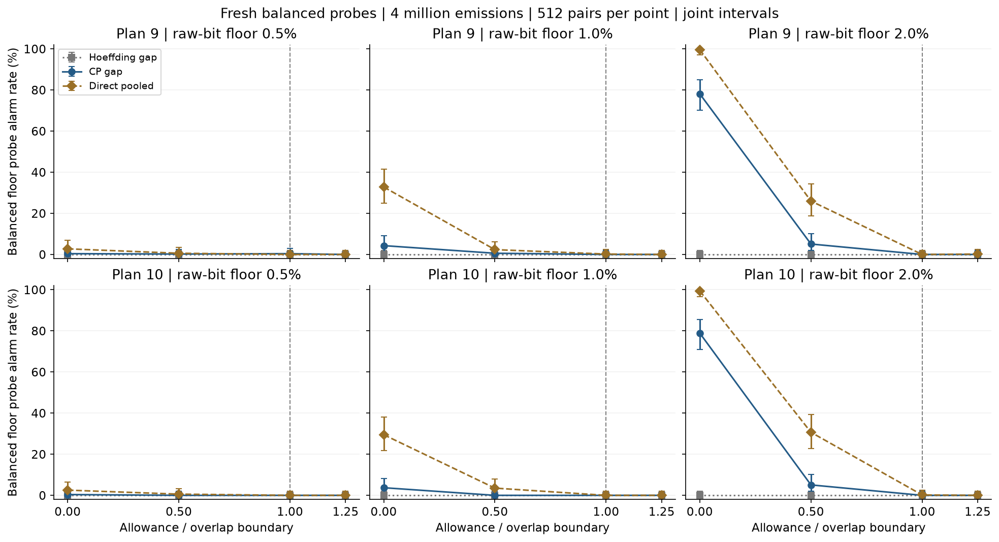
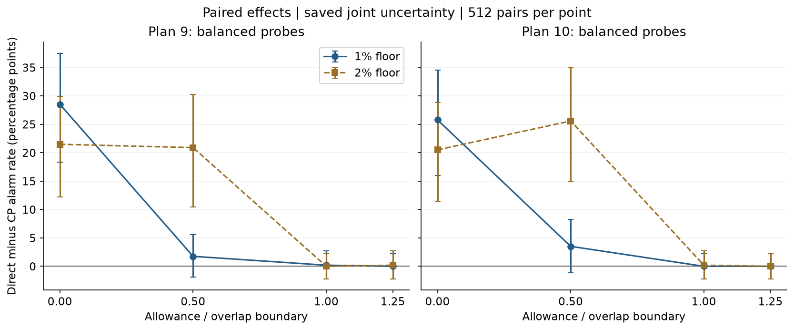
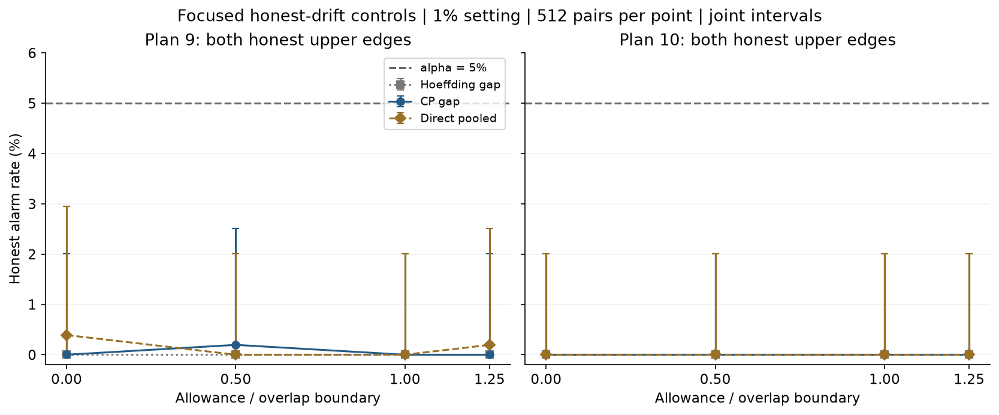

# Step 12 results: a stronger direct test, with important limits

Completed 2026-10-09. **Ready within the reviewed simulation scope, with caveats.**
The new direct pooled test has a stated model-wide real-arithmetic false-alarm
proof and improves pointwise detection in several fresh, predeclared settings.
It does not solve weak-attack sensitivity under moderate drift, the population
overlap obstruction or publication novelty. A new inequality or quantum-security
theorem is not claimed.

## What changed, and why it is legitimate

The [complete derivation](direct-drift-test.md) uses three established tools:
exact one-sided binomial confidence bounds, Bernstein concentration for error
differences, and direct Hoeffding concentration for stable gains. Preparation-bit
counts are pooled **within**, not across, the Z and X bases. Pooling is valid
under the approved shared-bit error probabilities and independent selection.
Unknown variance is bounded with an explicitly budgeted failure event rather
than substituting a fitted noise rate into an oracle threshold.

Both error directions and both gain directions remain checked. The eight
internal directions together spend alpha=.05; no OR of separate methods is
evaluated. The proof does not assume the variance confidence event is independent
of the observed difference. There is no adjustable alpha split, direction
selection, fitted drift bound, nuisance optimizer or private-label input.

The [frozen protocol](direct-drift-protocol.md) specifies a new seed, 2026100912,
and the same two resource plans, three floors, four allowance levels and nine
cohorts per setting as Step 11. There are 216 cohorts × 512 pairs = **110,592
new public pairs**. All three methods score identical observations. No row is
filtered, no result is tuned and the old pilot is not overwritten.

## Evidence

- [Summary, protocols, rate cells and paired effects](../results/benchmarks/direct-drift-pilot-v1/pilot.json).
- [Every public count pair and all three decisions](../results/benchmarks/direct-drift-pilot-v1/public_counts.csv.gz).
- [Replay audit](../results/benchmarks/direct-drift-pilot-v1/audit.json).
- [Executed companion notebook](../notebooks/direct_drift_pilot.ipynb).
- [Detector](../src/research/direct_drift_detector.py), [runner](../scripts/run_direct_drift_pilot.py), [auditor](../scripts/audit_direct_drift_pilot.py).
- [Notebook builder](../scripts/build_direct_drift_notebook.py) and [tooling dependencies](../requirements-notebooks.txt).

Frozen numerical environment: Python 3.12.14, NumPy 2.5.3 and SciPy 1.18.1.
Eleven source fingerprints and the raw-archive fingerprint are saved. Only the
three reviewed evidence files are allow-listed for Git; the environment remains
ignored. Nothing is committed or pushed at this milestone.

## Fair comparisons and uncertainty

Each pair has four million emitted pulses. Both plans keep
C=M+f*(B-M)=2,000,000, matching expected sacrifice and raw-candidate counts.
They do not match hardware latency, energy or final secure-key yield. Realized
counts are saved and reconciled, not substituted with their expectations.
The expected exactly-known retained raw-bit proxy r/2 is not mutual information
or final-key leakage.

All 648 rate cells have marginal 95% exact-binomial intervals and joint intervals
with per-cell failure .04/648. Each of 216 paired effects uses separate binomial
intervals for the mutually exclusive events "only direct" and "only CP", each
with failure .01/(216*2). Subtracting their endpoints yields a conservative
paired rate-difference interval; independence of these two counts is unnecessary.
The full collection of rate/effect intervals covers jointly with at least 95%
probability in real arithmetic. This is Monte Carlo uncertainty, separate from
each detector's alpha=.05 false-alarm budget.

Methods share an **upper** alpha guarantee, not an identical attained FPR. The
paired intervals measure the difference at the saved test settings; they do
not establish equal-attained-FPR superiority or a continuous minimum over Eve.

## Main fixed example: plan 9, balanced 1% floor probe

Here r=.02 and Eve's Z-basis probability beta=.5. Allowances are absolute QBER
percentage-point changes per basis. These rows were part of the frozen protocol,
not selected to define a new evaluation after seeing outcomes.

| Per-basis allowance (QBER pp) | CP alarms | Direct alarms | Direct minus CP (pp) | Joint paired interval (pp) |
|---|---:|---:|---:|---|
| 0 | 22/512 (4.30%) | 168/512 (32.81%) | +28.52 | [18.37,37.50] |
| 0.2425 | 3/512 (0.59%) | 12/512 (2.34%) | +1.76 | [-1.93,5.61] |
| 0.4850 | 0/512 (0%) | 1/512 (0.20%) | +0.20 | [-2.20,2.72] |
| 0.60625 | 0/512 (0%) | 0/512 (0%) | 0 | [-2.20,2.20] |

At zero allowance the CP rate's joint interval is [1.57%,9.03%] and the direct
rate's is [24.84%,41.53%]. The conclusion that this particular gain is supported
uses the **paired effect interval**, not just comparing those separate intervals.
At half the boundary the effect interval includes zero, so that apparent gain
is not established at the saved joint level. Even 32.81% detection misses most
trials; the project should not call this adequate weak-attack protection.

Plan 10 has analogous zero-allowance balanced 1% counts: CP 19/512 (3.71%)
and direct 151/512 (29.49%), with paired joint gain interval [15.96,34.58] pp.
At half the boundary direct is only 18/512 (3.52%). No allocation winner is
claimed from these limited probes.

The earlier Step 11 CP count of 31/512 used a different seed. The present
22/512 is a fresh Monte Carlo estimate of that same setting, not a changed
threshold or a selected rerun. Compare the new methods on these **same new
pairs**, not by subtracting an old pilot rate from a new one.



## Improvements that survive paired uncertainty, and retained losses

Across the **96 fixed attack-probe comparisons**, direct's observed rate is
higher in 76, lower in 3 and tied in 17. Of these, 43 saved paired intervals
are wholly above zero; none is wholly below zero. These are comparisons across
the declared probes, not a statistical sample of all attack policies or a
uniform dominance theorem. All honest-control effects are retained too, but
more alarms on honest laws are false alarms, not beneficial detections.

At the 2% floor and half the overlap-boundary allowance, balanced plan 9 rates
are CP 26/512 (5.08%) and direct 133/512 (25.98%), with paired gain interval
[10.49,30.27] pp. Plan 10 gives 26/512 and 157/512 (30.66%), with gain interval
[14.94,34.99] pp. Sensitivity remains limited even in these improved cases.

The three negative observed effects are kept explicitly:

| Plan | Floor | Allowance multiplier | Probe | Only direct | Only CP |
|---|---|---|---|---:|---:|
| 9 | 0.5% | 1 | balanced floor | 0 | 2 |
| 9 | 1% | 1 | floor beta=.25 | 0 | 2 |
| 9 | 1% | 1.25 | floor beta=.25 | 1 | 2 |

All three difference intervals include zero. No individual-transcript
dominance is claimed, and failures near population overlap are expected.



## Honest controls and the stronger-attack contrast

Across 120 honest cohorts per method, Hoeffding has 0/512 alarms in each;
CP ranges from 0–3/512 and direct from 0–2/512. The largest saved joint rate
upper endpoints are respectively 2.01%, 3.34% and 2.95%. These observations
describe the tested laws only. The uniform null guarantee comes from the model
and proof, not low measured false-alarm counts. Zero-transmission rows stay in
the evidence, and zero observed alarms is not zero true probability.



For the stronger balanced probe r=.04 in plan 9's 1%-floor setting at half the
boundary, CP alarms in 143/512 (27.93%) and direct in 444/512 (86.72%). This
probe has a **2%** raw-bit proxy, not 1%; its high detection cannot represent
worst-case floor-family performance. Stronger attacks can remain distinguishable
even when another eligible attack exactly matches an allowed honest law.

## Why this is promising, but not yet a novelty claim

The project now has a precise operational question, a physically admissible
honest-noise family, an impossibility boundary, two transparent baseline rules,
a new standard-tool direct construction and resource-matched fresh paired
evidence. That is stronger engineering/research evidence than simulator-label
accuracy alone. The mathematical tools are established; we have not experimentally
isolated pooling from direct concentration with an ablation.

Neither an observed gain nor a scoped derivation proves publication priority.
The targeted prior-art comparison is not a systematic priority assessment.
There is no new
physics, quantum advantage, general attack detector or final-key security proof.

The original overlap condition `(1-lambda)*kappa <= d_Z+d_X` remains unchanged.
At/above it, any uniformly valid rule has worst-case power at most alpha for
the approved continuous family. Below it, poor finite-sample sensitivity can
still persist; the fresh half-boundary 1% results demonstrate that limitation.

## Checks and reproducibility

There are **47 new tests**: 39 detector tests and 8 pilot tests. They cover
readonly/public-only behavior, pooling and stage/bit symmetries, zero counts,
coordinate isolation, lawful envelope monotonicity, exact one-sided confidence
coverage at 15 finite-grid settings, eight exhaustive finite-null error-coordinate
enumerations, four independent scalar radii, invalid inputs, paired bookkeeping,
tiny-run complete reconstruction, metadata/fingerprint deletion and overwrite refusal.
These selected finite grids are checks, not substitutes for the uniform proof.

The full suite passes **869 tests in 60.46 seconds**. The full audit regenerates
**110,592** public pairs, replays **331,776** decisions, reconciles every one
of **648** rates and **216** paired effects, and independently checks **1,944**
first/middle/last scalar decisions. The scalar CP reference shares SciPy; there
is no separate-library, hardware or outward-rounded numerical certificate.
Step 7's 26 and Step 11's 9 recorded source/output fingerprints still match.

Run from the repository root with the project environment:

```sh
python quantum-ai-lab/scripts/run_direct_drift_pilot.py --output quantum-ai-lab/results/benchmarks/direct-drift-pilot-v2
python quantum-ai-lab/scripts/audit_direct_drift_pilot.py quantum-ai-lab/results/benchmarks/direct-drift-pilot-v1
python -m pip install -r quantum-ai-lab/requirements-notebooks.txt
python quantum-ai-lab/scripts/build_direct_drift_notebook.py
```

The first command replays the same design into a **new** directory; it does not
authorize a changed campaign. The executed notebook reads v1 deliberately.
Full notebook viewport inspection is unavailable under the local-file browser
policy; inspect it in a local notebook viewer. Figures and executed text outputs
are checked separately, without bypassing that browser restriction.

## Proposed next milestone — confirmation required

Freeze a bounded continuous-bias stress search with independent final evaluation,
plus a pooled-CP ablation to separate pooling from the changed statistic. This
would test how broad the apparent advantage is and where Eve can evade it.
A sampled bias grid alone still cannot certify the continuous minimum. Any
interval/analytic certification or larger attacked-channel drift family needs
its own derivation and budget; do not silently relabel these fixed-probe results.

This next work is **not** implemented here. Prior benchmarks, historical PDFs
and Git history are not rewritten. There is no commit, push or submission.
