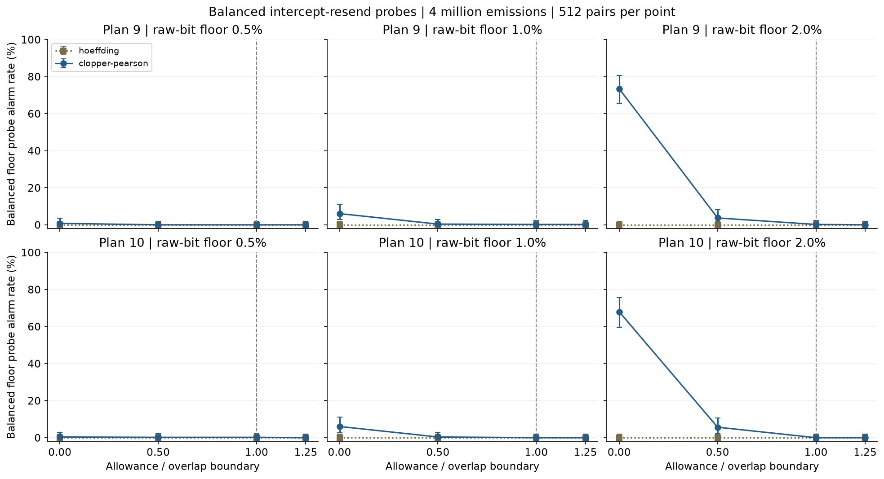
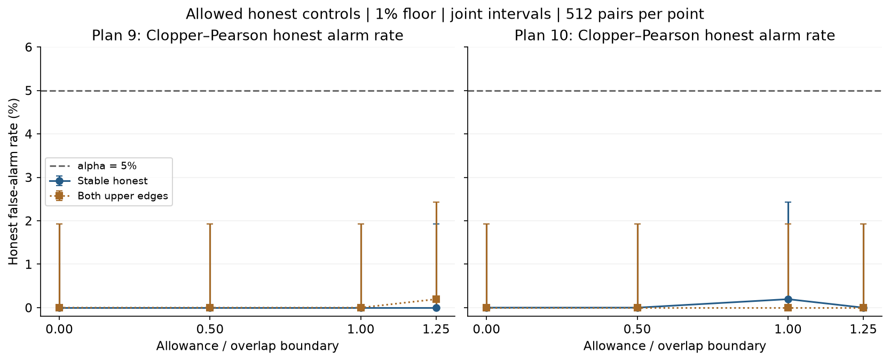

# Step 11: frozen bounded-drift pilot results

Completed 2026-10-09. **The pilot is complete; a publishable novel detector is not.**
The approved baseline is reproducible and consistent with its model/proof, but
weak-attack detection at the fixed resource budget is inadequate. Failures are
retained, not repaired by selecting favorable settings after seeing the data.

## What question did we answer?

Can the two Step 10 confidence-gap rules retain sensitivity while treating a
predeclared amount of honest between-block QBER change as normal? QBER is the
fraction of mismatches among publicly compared sifted bits. A drift allowance
is an **absolute probability difference**, not a relative percentage increase.
Eve's r/2 is an expected exactly-known retained raw-bit proxy under this
restricted intercept-resend model, not mutual information or final-key leakage.

The [protocol](drift-pilot-protocol.md) was frozen before the full run. Each rule
has alpha=.05 fixed-horizon model-wide false-alarm control, not equal attained
FPR and not .05 for an OR of both rules. Each pair has four million emitted
pulses; the two fixed allocations match expected sacrifice and raw-candidate
counts. Floors are 0.5%, 1% and 2%; there are four equal-basis allowance levels,
five honest controls and four fixed attacks. There are **216 cohorts × 512
pairs = 110,592 pairs** and **432** saved alarm rates. No row was excluded.

## Evidence and reproducibility

- [Summary and protocol metadata](../results/benchmarks/drift-pilot-v1/pilot.json).
- [Every public count pair and both decisions](../results/benchmarks/drift-pilot-v1/public_counts.csv.gz) (6.54 MB compressed).
- [Replay audit](../results/benchmarks/drift-pilot-v1/audit.json).
- [Executed companion notebook](../notebooks/drift_pilot.ipynb).
- [Runner](../scripts/run_drift_pilot.py) and [auditor](../scripts/audit_drift_pilot.py).
- [Notebook builder](../scripts/build_drift_notebook.py) and [notebook tooling](../../requirements.txt).

Frozen numerical environment: Python 3.12.14, NumPy 2.5.3, SciPy 1.18.1.
Seed=2026100911 with separate calibration/monitoring streams and independently
seeded cohorts. Both rules see the same observations. Eight source fingerprints
and the raw archive fingerprint are saved; the output directory cannot be
overwritten by the runner. The notebook only reads evidence and regenerates figures.

From the repository root, using its environment:

```sh
python quantum-ai-lab/scripts/run_drift_pilot.py --output quantum-ai-lab/results/benchmarks/drift-pilot-v2
python quantum-ai-lab/scripts/audit_drift_pilot.py quantum-ai-lab/results/benchmarks/drift-pilot-v1
python -m pip install -r requirements.txt
python quantum-ai-lab/scripts/build_drift_notebook.py
```

The first command recreates the same frozen design in a **new** directory, not
a new tuned experiment. The notebook references v1 deliberately. Temporary
kernel communication requires local process/port access; no global kernel
registration or cloud service is required. The ignored virtual environment is
not added to version control. Only three reviewed pilot evidence files are
allow-listed; other generated result directories remain ignored.

## Uncertainty: what the intervals mean

Each rate uses 512 independent pairs. Marginal exact-binomial 95% intervals and
joint endpoints are saved. The joint rate intervals spend 0.04/432 per rate;
the 24 one-sided mean bounds spend 0.01/24 each. By the union bound the combined
rate/bound coverage is at least 95% in real arithmetic. This is Monte Carlo
estimation uncertainty, separate from the detector's alpha=.05 error budget.
No family-wide inference is obtained just by taking the minimum of four probes.

## Main results

### Balanced floor probe and stronger contrast

The following table is **plan 9, kappa=1%, Clopper–Pearson only**. For the floor
probe r=.02 and beta=.5; the stronger contrast uses r=.04 and beta=.5, hence a
2% raw-bit proxy. All rates are counts divided by 512. Joint intervals below
are the saved simultaneous endpoints, in percent.

| Equal per-basis drift allowance (QBER percentage points) | Balanced floor alarms | Rate; joint interval | Double-rate alarms | Rate; joint interval |
|---|---:|---|---:|---|
| 0 | 31/512 | 6.05%; [2.74%, 11.21%] | 392/512 | 76.56%; [68.64%, 83.38%] |
| 0.2425 | 2/512 | 0.39%; [0.0019%, 2.86%] | 157/512 | 30.66%; [23.06%, 39.07%] |
| 0.4850 | 1/512 | 0.20%; [0.0000090%, 2.43%] | 27/512 | 5.27%; [2.23%, 10.20%] |
| 0.60625 | 1/512 | 0.20%; [0.0000090%, 2.43%] | 11/512 | 2.15%; [0.48%, 5.84%] |

For plan 10 at the same floor the balanced floor counts are 31, 2, 0 and 0;
the double-rate counts are 363, 120, 18 and 3. These selected rows illustrate
the effect, not a globally best allocation. Some allocation comparisons share
overlapping uncertainty and the attack probes are not all possible policies.

At the 2% floor, the zero-allowance balanced CP counts are 376/512 (73.44%) and
348/512 (67.97%) for plans 9 and 10. At half the boundary they fall to 19/512
(3.71%) and 29/512 (5.66%). The notebook shows these with joint uncertainty,
alongside all three declared floors and both allocations.



### Honest controls

Over all 120 tested honest cohorts per method, Hoeffding has **0/512** alarms
in each cohort; CP ranges from **0/512 to 2/512** (0–0.39%). The largest saved
joint upper endpoint is 1.93% for Hoeffding and 2.86% for CP. These concern the
**tested laws only**, not a sampled proof for every member of the honest family.
Zero observed alarms is not zero true false-alarm probability. Zero-transmission
cohorts are retained. At zero allowance the four nonzero-transmission honest
laws coincide but are independently seeded; they are not pooled into a new rate.



### Hoeffding decisions and continuous-family lower function

All **110,592** Hoeffding decisions are no-alarm. Every sampled conditional
lower function is zero; all **24** sample mean functions and one-sided joint
lower endpoints are zero. The function bounds the Hoeffding rule only, not CP.

This is an **uninformative bound**, not proof that an optimal detector has zero
power. Separate probability-free interval widths are too large for these small
QBER changes at the effective per-coordinate counts. CP uses the binomial
probabilities and is tighter here, but still loses weak-floor sensitivity.
The empirical difference between two attained FPRs is not a comparison at
equal attained FPR; both only share the same upper alpha guarantee.

## Physics and statistical interpretation

For the fixed-noise balanced floor attack, both basis errors increase by
(1-lambda)*kappa/2. With lambda=.03 and kappa=.01 this is .00485, or **0.485
QBER percentage points**. If the allowed honest change is at least this large
in each basis, the attack's complete public-count law is also an allowed honest
law (with the same calibration and gains). No additional sample budget can
separate identical laws while maintaining uniform honest false-alarm control.
The [model/proof note](bounded-drift-model.md) gives the exact general criterion
`(1-lambda)*kappa <= d_Z+d_X`, with its positive-observation-resource assumptions.

Below this boundary the populations are distinguishable in the approved family,
but finite data and a conservative decision rule can still yield poor power.
This pilot exhibits that second failure too. Stronger attacks can remain easier
to detect even when **some** floor-eligible attack overlaps: the theorem is
about family-wide worst-case power, not every attack's pointwise power.

The project is now testing a more meaningful question than detecting idealized
simulator labels: which changes remain detectable after granting honest noise
the same observational explanation? This scoped simulation/proof application
is not evidence of new quantum physics or publication priority.

## Validation actually performed

- **20 new tests** cover frozen dimensions/budgets, lawful numerical edges,
  eligibility, deterministic seed replay, tiny-run complete audit, bad metadata,
  supported trial counts and refusal to overwrite existing results.
- Full suite: **822 passed in 38.82 seconds** in this environment.
- Audit regenerates **110,592** public pairs from saved laws/seeds and replays
  **221,184** method decisions, all matching saved counts and decisions.
- Independently expressed scalar checks cover **1,296** first/middle/last-row
  decisions and **12,288** conditional lower-function rows.
- All **26** recorded Step 7 source/output fingerprints still match.
- The 17-cell notebook executes top-to-bottom; source/archive hashes and
  selected exact rates are checked. Its saved figures and text outputs are
  inspected. Full browser-based notebook layout inspection was blocked by the
  local-file URL policy; no bypass was attempted. Open the notebook locally to
  check the complete reading layout. Numerical references for CP share SciPy, and there is no
  outward-rounded floating-point certificate or hardware validation.

## Limits and recommended next milestone

The pilot does **not** cover time-correlated/adaptive Eve, arbitrary quantum
attacks, compromised calibration, concurrent attack/noise drift, changing
gains/intensities/device efficiencies, repeated peeking, optimized allocations,
continuous best-response minima or final-key security. The drift allowances
are sensitivity assumptions, not empirically measured device specifications.
The closest paper's threshold-classification accuracy is a different estimand
and cannot be used as our detection-power baseline. The prior-art review remains
incomplete; the experimental comparison does not establish publication priority.

Proposed Step 12, **subject to confirmation**: derive a tighter direct
two-sample test of bounded drift with a false-alarm guarantee uniform over
unknown honest nuisance probabilities, retaining finite trusted calibration.
Pooling preparation-bit strata is one candidate because their probabilities
are shared under this model; an ordinary equal-probability Fisher test cannot
simply be reused when nonzero drift is allowed. Preserve the same observables,
resources and alpha, specify the proof before benchmarking, and freeze a fresh
evaluation rather than tune and evaluate on these pilot results.

No next detector has been implemented; no historical PDF, prior benchmark or
Git history has been rewritten; no commit, push or submission is made here.
